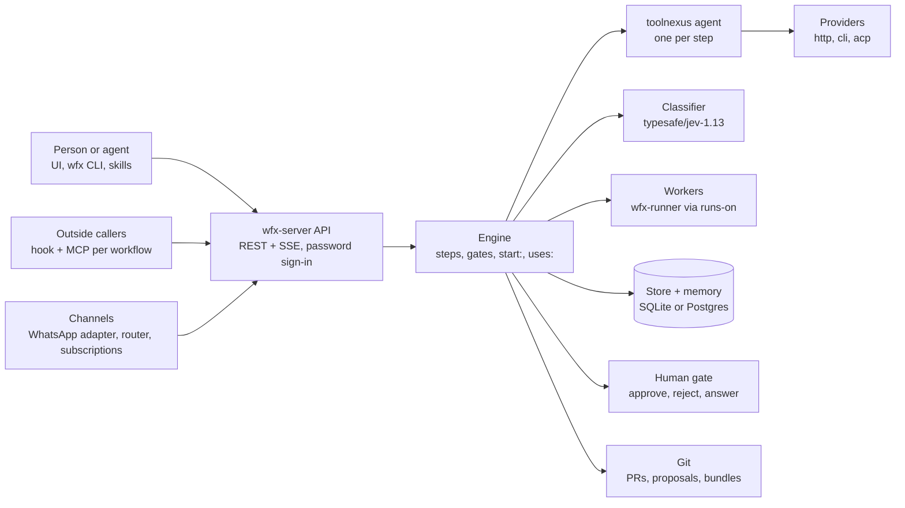

# Architecture

wfnexus runs YAML workflows. Each step is an agent with scoped skills and a typed output.

## What lives where

- `apps/api` builds `wfx-server`: API, engine and the embedded UI from `apps/ui`.
- `apps/api/cmd/wfx` is the CLI. `apps/api/cmd/wfx-runner` is an outbound-only worker.
- `internal/workflow` loads YAML: steps, jobs, `runs-on`, `start:`, `uses:`.
- `internal/engine` runs steps, gates, schedules, channels, subscriptions and memory.
- `internal/catalog` lists what a step can name: providers, classifiers, MCP servers, channels.
- `agentadapter/` turns ACP or CLI agents (claude, codex, devin, opencode) into models.
- `internal/judge` sends typed questions to the classifier and maps verdicts to bands.
- `internal/store` persists runs, steps and memory in SQLite (local) or Postgres (server).
- `adapters/` holds channel adapters, such as `apl-whatsapp.js`.
- `templates/` holds shipped workflows, including the WhatsApp sender, monitor, router and frontdesk.

## How a run flows

1. A run starts from the UI, `wfx run`, a cron, a channel message, a hook or an MCP call.
2. The engine checks the input schema and the concurrency group, then orders the steps.
3. Each agent step runs as one toolnexus agent on its provider, here or on a worker (`runs-on`).
4. The step must return output that validates against its schema; the classifier answers `decide:` / `judge:`.
5. A gate pauses the run until a person approves, rejects or answers (UI, CLI or channel).
6. The run writes memory (per workflow, and per chat for conversations) and its result lands in git.

## Where to change X

| X | Change here |
|---|---|
| Workflow YAML shape | `apps/api/internal/workflow/` |
| Step execution, gates, retries | `apps/api/internal/engine/step.go`, `engine.go` |
| Starting child workflows (`start:`) | `apps/api/internal/engine/start.go` |
| Workers and `runs-on` | `apps/api/internal/engine/workers.go`, `apps/api/cmd/wfx-runner/` |
| Memory | `apps/api/internal/engine/memory.go` |
| Channels, subscriptions, WhatsApp | `apps/api/internal/engine/channels.go`, `subscriptions.go`, `adapters/` |
| Hooks and MCP door | `apps/api/internal/api/expose.go` |
| Sign-in and roles | `apps/api/internal/api/password.go`, `apps/api/internal/auth/` |
| Default classifier and config | `apps/api/internal/config/config.go` |
| Providers and agent CLIs | `apps/api/internal/catalog/`, `agentadapter/` |

## Sources

- toolnexus is the core: `docs/adr/0001-toolnexus-is-the-core.md`, `docs/adr/0002-a-step-is-an-agent-not-a-prompt.md`, `apps/api/go.mod`, `apps/api/internal/engine/agent.go`
- Typed output: `docs/adr/0003-typed-handoff-via-submit-output.md`
- `runs-on`: `apps/api/internal/workflow/workflow.go`, `apps/api/internal/engine/workers.go`, `docs/adr/0015-a-step-runs-where-it-says-it-runs.md`
- `start:`: `apps/api/internal/workflow/workflow.go`, `apps/api/internal/engine/start.go`
- `uses:`: `apps/api/internal/workflow/jobs.go`, `apps/api/internal/workflow/task.go`
- Memory per workflow and per conversation: `apps/api/internal/engine/memory.go` (`consolidateMemoryIn`), `apps/api/internal/engine/conversation.go`
- Classifier default `typesafe/jev-1.13`: `apps/api/internal/config/config.go`
- Channels and WhatsApp: `apps/api/internal/engine/channels.go`, `adapters/apl-whatsapp.js`, `docs/adr/0023-channels-are-commands-and-replies-need-an-allow-list.md`, `docs/adr/0026-whatsapp-only-subscriptions-conversations-and-default-workflows.md`
- Subscriptions and router: `apps/api/internal/engine/subscriptions.go`, `templates/router`, `docs/adr/0024-messaging-is-subscriptions-on-one-inbox-per-account.md`
- Hooks and MCP per workflow: `apps/api/internal/api/expose.go`, `docs/adr/0027-every-workflow-is-a-hook-and-an-mcp-tool-behind-its-own-token.md`
- Password sign-in: `apps/api/internal/api/password.go`, `docs/adr/0025-username-and-password-sign-in-with-roles.md`
- carry for tools: `apps/api/cmd/wfx/carry.go`, `apps/api/internal/carryops/carryops.go`
- Human gates: `docs/adr/0021-a-pause-names-who-may-answer.md`, `apps/api/internal/notify/`
